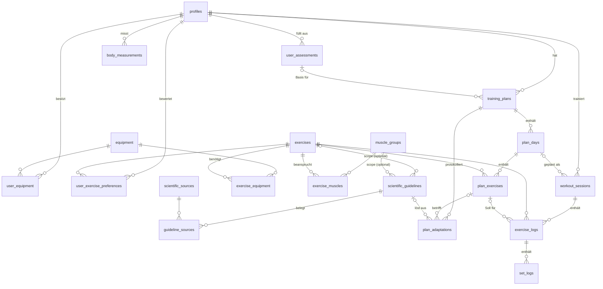

# Schritt 1 – Datenbank-Schema & Datenmodelle

> Status: **Vorschlag zur Freigabe**
> SQL: [`supabase/migrations/20261105000000_initial_schema.sql`](../supabase/migrations/20261105000000_initial_schema.sql),
> Ergänzung Schritt 5: [`20261106000000_deload_sessions.sql`](../supabase/migrations/20261106000000_deload_sessions.sql) (`workout_sessions.is_deload`)

## Vorgeschlagener Tech-Stack

Die App soll als Web-App auf allen Plattformen laufen. Deshalb:

| Ebene | Wahl | Warum |
|---|---|---|
| Frontend | **Next.js (App Router) + TypeScript + Tailwind CSS** | Ein Code-Stand für Desktop, iOS und Android, Mobile-First |
| Plattform | **Progressive Web App (PWA)** | Auf jedem Handy „zum Startbildschirm hinzufügen“, Vollbild, **offline nutzbar** (Gyms haben oft schlechten Empfang) |
| Backend/DB | **Supabase** (PostgreSQL, Auth, Row Level Security) | Relationales Modell passt zu Trainingsdaten, Auth inklusive, Zugriffsschutz direkt in der DB |
| State | Zustand (Live-Workout) + TanStack Query (Server-Daten) | Workout-Zustand überlebt Reloads, Server-Cache getrennt |
| Offline-Puffer | IndexedDB (Dexie) | Sätze werden lokal gespeichert und später synchronisiert |
| Charts | Recharts | Schritt 5 |

Das Schema ist darauf ausgelegt: Alle IDs sind **UUIDs, die der Client selbst erzeugen kann**. So kann ein Satz
offline angelegt und später per `upsert` hochgeladen werden, ohne ID-Konflikte.

## Trainingsziel: Optik & Pump

Das Hauptziel der App ist die **optische Verbesserung**, der Pump steht dabei im Vordergrund. Was die Forschung
dazu sagt, prägt das Schema:

- **Der Pump ist ein gutes Gefühl, aber kein belegter Wachstumstreiber.** Er ist eine vorübergehende Schwellung des
  Muskels. Dass dieser „metabolische Stress“ zusätzlich zum Wachstum beiträgt, ist eine Hypothese
  (Schoenfeld & Contreras 2014). Hauptauslöser für Muskelwachstum ist mechanische Spannung (Wackerhage et al. 2019),
  also Sätze nahe am Versagen mit ausreichend Volumen.
- **Pump-Techniken sind effizient, aber kein Muss.** Dropsätze und Rest-Pause bringen ähnliches Wachstum wie
  klassische Sätze, nur in weniger Zeit (Sødal et al. 2023, Prestes et al. 2019).
- **Optik = Muskelmasse + Proportionen + Körperfett.** Proportionen lassen sich über Prioritätsmuskeln steuern.
  Körperfett hängt vor allem an der Ernährung und wird hier nur gemessen, nicht gesteuert.

Was das Schema daraus macht:

| Baustein | Umsetzung |
|---|---|
| **„Muskelaufbau & Optik“ als Standardziel** | `user_assessments.goal` ist standardmäßig `hypertrophy`. Die Richtwerte werden zuerst für dieses Ziel gepflegt. |
| **Proportionen** | `user_assessments.priority_muscle_ids`: Das Onboarding fragt nach Körperpartien (z. B. Schultern/V-Form, Arme, Brust, Beine/Po). Diese bekommen Volumen am oberen Ende der Spanne. |
| **Übungen mit Dehnungsfokus** | `exercises.resistance_profile` (`lengthened` / `mid_range` / `shortened`). Übungen, die den Muskel in gedehnter Position belasten, werden bevorzugt (Maeo et al. 2021, 2023; Pedrosa et al. 2022). |
| **Pump-Finisher** | `plan_exercises.last_set_technique`: Dropsatz, Myo-Reps, Rest-Pause oder Lengthened Partials im letzten Satz. Ein Richtwert (`intensity_technique`) erlaubt das nur bei Isolationsübungen, nicht bei schweren Grundübungen wie Kniebeuge oder Kreuzheben. |
| **Pump als persönliches Feedback** | Nach jeder Übung: `exercise_logs.pump_rating` (0–3) und `joint_discomfort` (0–3). Die View `exercise_feedback_summary` zeigt, welche Übungen dir Pump geben und welche zwicken. Beim Übungswechsel werden Übungen mit gutem Pump und ohne Gelenkprobleme bevorzugt. |
| **Optischer Fortschritt messbar** | `body_measurements`: Umfänge (Schultern, Brust, Taille, Hüfte, Oberarm, Oberschenkel, Wade), Gewicht, Körperfett. Grundlage für die Charts in Schritt 5. |
| **Fokus auf den Zielmuskel** | Richtwert `attentional_focus`: Bewusstes „Spüren“ des Zielmuskels brachte bei Bizeps-Training mehr Wachstum (Schoenfeld et al. 2018). |

Wichtig für die Ehrlichkeit der App: Pump-Feedback ist ein **Hilfssignal** mit der Evidenzstufe Expertenmeinung.
Ob trainiert wird, entscheiden weiterhin Volumen, Nähe zum Versagen und Progression. Ein Training ohne Pump ist kein
schlechtes Training.

## Überblick: 5 Bereiche, 20 Tabellen, 4 Views



### Zuordnung zu den angefragten Entitäten

| Angefragt | Umsetzung |
|---|---|
| **Users** | `profiles` (verknüpft mit Supabase `auth.users`), `user_assessments`, `user_equipment`, `user_exercise_preferences`, `body_measurements` |
| **Workouts** | Soll: `training_plans` → `plan_days` → `plan_exercises` · Ist: `workout_sessions` |
| **Exercises** | `exercises` + `exercise_muscles` (primär/sekundär) + `exercise_equipment` |
| **Sets** | Soll: `plan_exercises.target_sets/reps/rir/last_set_technique` · Ist: `set_logs` |
| **Logs** | `workout_sessions` → `exercise_logs` (inkl. Pump-Feedback) → `set_logs` sowie `plan_adaptations` (Änderungen am Plan) |
| **ScientificGuidelines** | `scientific_guidelines` + `scientific_sources` + `guideline_sources` |

Die wichtigste Trennung ist **Soll** (Plan) gegen **Ist** (Log). Ein Plan kann sich ändern, ohne die Historie zu
verfälschen. Die Historie hängt an der Übung (`exercise_id`), nicht am Plan, damit „Letztes Mal“ und die Charts
auch nach einem Planwechsel weiterlaufen.

## Die Tabellen im Detail

### A. Katalog (für alle lesbar, gepflegt per Migration/Admin)

| Tabelle | Zweck | Wichtige Felder |
|---|---|---|
| `muscle_groups` | ca. 17 Muskelgruppen | `slug`, `name_de`, `region` (upper/lower/core) |
| `equipment` | Langhantel, Kurzhantel, Kabel, Maschine, Klimmzugstange, … | `slug`, `name_de` |
| `exercises` | Übungs-Bibliothek mit Detailseite | `instructions[]`, `common_mistakes[]`, `cues[]`, `image_url`/`video_url`/`gif_url`, `mechanic` (compound/isolation), `movement_pattern`, `resistance_profile`, `systemic_fatigue` (1–5), `load_increment_kg`, `tracking_type` |
| `exercise_muscles` | Primär-/Sekundärmuskeln | `role`, `contribution` (1.0 / 0.5) |
| `exercise_equipment` | Benötigtes Equipment | n:m |

Eigene Übungen: `exercises.created_by` ist bei Katalog-Übungen `NULL`. Bei eigenen Übungen steht dort die
Nutzer-ID, und nur dieser Nutzer sieht sie.

### B. Wissenschaft

| Tabelle | Zweck |
|---|---|
| `scientific_sources` | Studien und Positionspapiere (Zitat, Jahr, DOI, Typ: Meta-Analyse, RCT, …) |
| `scientific_guidelines` | Die Richtwerte als **Regeln mit Geltungsbereich** (siehe unten). Zahlenwerte (`min`/`max`) oder rein qualitativ (`unit = 'qualitative'`, z. B. Fokus-Hinweise). |
| `guideline_sources` | n:m, jeder Richtwert ist mit seinen Quellen belegt |

### C. Nutzer, Onboarding & Fortschritt

| Tabelle | Zweck |
|---|---|
| `profiles` | Anzeige-Einstellungen: `unit_system` (kg/lb), `effort_scale` (RIR oder RPE), `timezone` |
| `user_assessments` | Fragebogen: Ziel (Standard: Muskelaufbau & Optik), Erfahrung, Tage/Woche, Dauer, Wunsch-Split, **Prioritätsmuskeln**, Einschränkungen. **Versioniert**: jede Neubewertung ist eine neue Zeile. |
| `user_equipment` | Verfügbares Equipment, filtert die Übungsauswahl |
| `user_exercise_preferences` | Favoriten bzw. „vermeiden“ (z. B. wegen Schulterproblemen) |
| `body_measurements` | Umfänge, Gewicht und Körperfett je Messtag (ein Eintrag pro Tag) |

### D. Plan (Soll)

| Tabelle | Zweck |
|---|---|
| `training_plans` | Split, Ziel, Mesozyklus-Länge, aktuelle Woche. Maximal **ein aktiver Plan** pro Nutzer (Unique-Index). `parent_plan_id` hält die Herkunft bei Neugenerierung fest. |
| `plan_days` | z. B. „Push A“, „Upper 1“ |
| `plan_exercises` | Vorgabe je Übung: Sätze, Wdh.-Bereich, RIR-Bereich, Pause, **`target_load_kg`** (wird vom Progressions-Algorithmus gepflegt), Progressionsschema, **`last_set_technique`** (Pump-Finisher) |
| `plan_adaptations` | **Protokoll jeder Anpassung**: Typ (Last ↑, Satz +, Übungswechsel, Deload …), Grund (Stagnation, Ziel erreicht, Pump-/Gelenk-Feedback …), Vorher/Nachher (JSON), auslösender Richtwert, Status (vorgeschlagen/angenommen/abgelehnt/automatisch/rückgängig gemacht). Welche Anpassung automatisch passiert: [Adaptions-Strategie](adaptions-strategie.md) |

### E. Logs (Ist)

| Tabelle | Zweck |
|---|---|
| `workout_sessions` | Eine Trainingseinheit: Status, Start/Ende, Session-RPE, Körpergewicht. Maximal **ein laufendes Workout** pro Nutzer. |
| `exercise_logs` | Eine Übung in der Einheit, optional mit Verweis auf die Plan-Vorgabe, plus **`pump_rating`** und **`joint_discomfort`** |
| `set_logs` | Ein Satz: `set_type`, `weight_kg`, `reps`, `duration_seconds`, `rir`, tatsächliche Pause sowie **`e1rm_kg`** als berechnete Spalte. Satztypen: `warmup`, `working`, `backoff`, `amrap` sowie die Technik-Segmente `dropset`, `myo_reps`, `rest_pause`, `lengthened_partials` (jeweils eine eigene Zeile direkt nach dem Hauptsatz). |

### F. Views für Tracker und Charts

| View | Liefert | Wird genutzt für |
|---|---|---|
| `exercise_last_performance` | Sätze der letzten abgeschlossenen Einheit je Übung (als JSON, inkl. Technik-Segmente) | „Letztes Mal: 82,5 kg × 8 / 8 / 6 + Drop 60 × 8“ im Live-Tracker |
| `exercise_progress` | Je Übung und Einheit: Topgewicht, bestes e1RM, Tonnage, Sätze | Kraft-Charts, Stagnations-Erkennung |
| `weekly_muscle_volume` | Harte Sätze je Muskelgruppe und Kalenderwoche | Volumen-Charts, Warnungen bei zu wenig oder zu viel Volumen („Junk Volume“) |
| `exercise_feedback_summary` | Durchschnittlicher Pump und Gelenkbeschwerden je Übung | „Deine Pump-Übungen“, Übungswechsel |

Alle Views laufen mit `security_invoker`. Damit gelten die RLS-Regeln der Basistabellen, und jeder Nutzer sieht nur
seine eigenen Daten.

## Wie die wissenschaftlichen Richtwerte mit den Übungen verknüpft sind

### Die Idee: Regeln mit Geltungsbereich und einer Spezifitäts-Kaskade

Statt jede Übung einzeln mit Richtwerten zu verknüpfen (bei ca. 100 Übungen × 3 Zielen × 3 Erfahrungsstufen wären
das tausende Zeilen), ist jeder Richtwert eine **Regel mit optionalem Geltungsbereich**:

```
scientific_guidelines
  category        rep_range | rest_interval | proximity_to_failure | intensity_technique |
                  range_of_motion | attentional_focus | weekly_volume | …
  scope_goal              ┐
  scope_experience        │  NULL  = gilt für alle
  scope_mechanic          │  Wert  = muss zum Kontext passen
  scope_muscle_group_id   │
  scope_movement_pattern  │
  scope_exercise_id       ┘
  min_value, max_value, unit   (unit = 'qualitative' → reiner Text-Hinweis)
  title, message ("Lass {min}–{max} Wiederholungen im Tank"), rationale, evidence_grade
```

Eine Übung **erbt** Richtwerte über ihre Eigenschaften (Mechanik, Bewegungsmuster, Primärmuskeln). Passen mehrere
Regeln derselben Kategorie, gewinnt die **spezifischste**. Das funktioniert ähnlich wie bei CSS:

| Ebene | Gewicht |
|---|---|
| konkrete Übung | 32 |
| Bewegungsmuster | 16 |
| Muskelgruppe | 8 |
| Mechanik (compound/isolation) | 4 |
| Erfahrungsstufe | 2 |
| Ziel | 1 |

Die Gewichte sind Zweierpotenzen. Dadurch kann eine spezifischere Ebene nie durch eine Kombination allgemeinerer
Ebenen überstimmt werden. Die `specificity` ist eine **berechnete Spalte**, niemand muss sie von Hand pflegen.

### Beispiel (so im Test durchgelaufen)

Regeln in der Datenbank:

| key | Kategorie | Geltungsbereich | Wert | Spezifität |
|---|---|---|---|---|
| `rep_range.hypertrophy` | rep_range | Ziel = Hypertrophie | 6–12 Wdh. | 1 |
| `rep_range.hypertrophy.isolation` | rep_range | Ziel = Hypertrophie, Isolation | 10–20 Wdh. | 5 |
| `rep_range.hypertrophy.calves` | rep_range | … + Muskel = Waden | 12–25 Wdh. | 13 |
| `rir.default` | proximity_to_failure | – | RIR 0–3 | 0 |
| `rir.compound` | proximity_to_failure | Compound | RIR 1–3 | 4 |
| `rir.deadlift` | proximity_to_failure | Übung = Kreuzheben | RIR 2–3 | 32 |
| `rest.compound` | rest_interval | Compound | 120–180 s | 4 |
| `rest.isolation` | rest_interval | Isolation | 60–120 s | 4 |
| `technique.compound` | intensity_technique | Compound | max. 0 Technik-Sätze | 4 |
| `technique.isolation` | intensity_technique | Isolation | max. 1 Technik-Satz | 4 |
| `focus.isolation` | attentional_focus | Isolation | qualitativ: „Spür den Zielmuskel“ | 4 |

Ergebnis von `resolve_exercise_guidelines(übung, 'hypertrophy', 'intermediate')`:

| Übung | Wdh. | RIR | Pause | Pump-Finisher |
|---|---|---|---|---|
| Bankdrücken | 6–12 | 1–3 (compound) | 120–180 s | nein |
| Seitheben | 10–20 (isolation) | 0–3 (default) | 60–120 s | **1 Technik-Satz** + Fokus-Hinweis |
| Wadenheben | 12–25 (Waden) | 0–3 | 60–120 s | 1 Technik-Satz + Fokus-Hinweis |
| Kreuzheben | 6–12 | **2–3 (Override wegen hoher systemischer Ermüdung)** | 120–180 s | nein |

Für Volumen und Frequenz gibt es `resolve_muscle_guidelines(muskel, ziel, erfahrung)`. Damit bekommen Anfänger
z. B. 6–10 Sätze pro Woche statt 10–20.

### Wo die Richtwerte eingesetzt werden

1. **Plan-Generierung (Schritt 3):** Die aufgelösten Werte werden als Startwerte in `plan_exercises` kopiert
   (Sätze, Wdh.-Bereich, RIR, Pause, ggf. Pump-Finisher). Der Nutzer kann sie danach überschreiben.
2. **Live-Tracker (Schritt 4):** Beim Start eines Workouts werden die Richtwerte für alle Übungen in einem Aufruf
   geladen und **lokal zwischengespeichert**. Die Auswertung („11 Wdh. bei RIR 0, nächstes Mal +2,5 kg“) läuft als
   reine TypeScript-Logik im Client und funktioniert dadurch auch offline.
3. **Kontextsteuerung:** `contexts[]` legt fest, wo ein Richtwert erscheint (Onboarding, Plan-Builder,
   Übungsdetailseite, Tracker, Analyse). `severity` (info/tip/warning) steuert die Darstellung.
4. **Transparenz:** Jede automatische Plananpassung speichert in `plan_adaptations.guideline_id`, welcher Richtwert
   sie ausgelöst hat. Die App kann so immer erklären, *warum* etwas geändert wurde, inklusive Quelle.

### Wie das Schema die Plan-Adaption trägt (Vorschau Schritt 3)

| Signal (aus den Daten) | Quelle | Reaktion → `plan_adaptations` |
|---|---|---|
| Alle Arbeitssätze am oberen Ende des Wdh.-Bereichs bei Ziel-RIR | `set_logs` gegen `plan_exercises` | `increase_load` um `exercises.load_increment_kg` (doppelte Progression) |
| Bestes e1RM steigt über 3 oder mehr Einheiten nicht | `exercise_progress` | Vorschlag `swap_exercise` (gleiches Bewegungsmuster und gleicher Primärmuskel, verfügbares Equipment, nicht „vermeiden“, bevorzugt guter Pump und Dehnungsfokus) oder `deload` |
| Übung zwickt wiederholt im Gelenk | `exercise_feedback_summary` | Vorschlag `swap_exercise`, Grund `stimulus_feedback` |
| Wochenvolumen unter dem Minimum | `weekly_muscle_volume` gegen `resolve_muscle_guidelines` | `add_set` (Prioritätsmuskeln zuerst) |
| Wochenvolumen über dem Maximum | dito | Warnung „Junk Volume“ bzw. `remove_set` |
| Hohe Session-RPE und sinkende Leistung | `workout_sessions.session_rpe`, `exercise_progress` | `deload` |

## Wichtige Design-Entscheidungen

| Entscheidung | Begründung |
|---|---|
| **Gewicht immer in kg** | Keine gemischten Einheiten in Auswertungen. lb ist reine Anzeige (`profiles.unit_system`). |
| **Anstrengung immer als RIR** | Eine einzige gespeicherte Skala. RPE wird angezeigt als `10 − RIR` (RIR-basierte RPE-Skala, Zourdos et al. 2016, Helms et al. 2016). |
| **Fraktionale Sätze** | Sekundärmuskeln zählen mit `contribution = 0.5`. Ein Satz Bankdrücken zählt also 1 Satz Brust und 0,5 Sätze Trizeps (gängige Zählweise in der Volumenforschung). |
| **„Harter Satz“ = Satz mit RIR ≤ 4** | Aufwärmsätze und sehr leichte Sätze zählen nicht zum Volumen. |
| **Technik-Segmente zählen 0,5 Sätze** | Ein Dropsatz-Segment ist kurz und vorermüdet. Studien zeigen ähnliches Wachstum wie bei klassischen Sätzen, eine exakte Umrechnung ist aber nicht belegt. 0,5 ist eine gekennzeichnete Konvention, die an einer Stelle in der View angepasst werden kann. |
| **e1RM nur für Arbeitssätze mit 1–12 Wdh. und RIR ≤ 4** | Epley-Formel, RIR-korrigiert. Bei vielen Wdh., großem Abstand zum Versagen oder vorermüdeten Technik-Segmenten sind die Schätzungen zu ungenau und würden die Kraft-Charts verfälschen. |
| **Wochengrenzen in Nutzer-Zeitzone** | Ein Training am Sonntag um 23:30 Uhr zählt nicht in die nächste Woche. |
| **Assessments und Anpassungen versioniert** | Nachvollziehbar, warum ein Plan so aussieht, wie er aussieht. |
| **Row Level Security auf allen Tabellen** | Katalog lesbar, Nutzerdaten strikt isoliert. Kindtabellen (Sätze, Plan-Tage) erben den Schutz über ihre Eltern-Datensätze. |

## Getestet

Die Migration wurde lokal gegen **PostgreSQL 16** ausgeführt, mit einem Nachbau der Supabase-Rollen und des
`auth`-Schemas. Geprüft wurden:

- Richtwert-Auflösung: alle Beispiele aus der Tabelle oben, inklusive Pump-Finisher-Regeln, qualitativer Hinweise
  und Anfänger-Volumen. Richtwerte ohne Wert werden abgelehnt, sofern sie nicht qualitativ sind.
- Automatisches Anlegen des Profils bei der Registrierung, Standardziel „Muskelaufbau & Optik“
- e1RM (nicht für Technik-Segmente und Sätze mit RIR > 4), „Letztes Mal“ inklusive Dropsatz, Verlauf,
  Wochenvolumen mit fraktionalen Sätzen, Segment-Faktor 0,5 und Zeitzone
- Pump-/Gelenk-Feedback und Auswertung je Übung, ungültige Werte werden abgelehnt
- Pump-Finisher im Plan: nur Technik-Satztypen erlaubt
- Höchstens ein aktiver Plan pro Nutzer
- RLS: Nutzer B sieht keine Daten von A (auch nicht Körpermaße oder Auswertungen), kann keine Sätze in fremde Logs
  schreiben, keine Session an fremde Pläne hängen, keine Körpermaße für andere anlegen und keine Katalog-Übungen
  oder Richtwerte anlegen. Eigene Übungen bleiben privat.

## Wissenschaftliche Grundlage der Kategorien (wird in Schritt 3 mit DOIs geseedet)

| Kategorie | Kernaussage | Hauptquellen |
|---|---|---|
| Wiederholungsbereich | Hypertrophie ist über ein breites Spektrum (ca. 6–30 Wdh.) ähnlich, wenn nahe ans Versagen trainiert wird. Für das Optik-Ziel: Grundübungen 6–12, Isolation 10–20+ (gelenkschonend, mehr Pump). | Schoenfeld et al. 2021 (Repetition Continuum) |
| Nähe zum Versagen | Hypertrophie profitiert von Sätzen nahe am Versagen (ca. 0–3 RIR). Echtes Versagen ist nicht nötig. | Refalo et al. 2023, Robinson et al. 2024 |
| Pausen | Längere Pausen (≥ 2 min) bei schweren Mehrgelenksübungen verbessern Kraft und Volumen. | Schoenfeld et al. 2016, Grgic et al. 2018 |
| Wochenvolumen | Dosis-Wirkungs-Beziehung, ≥ 10 Sätze pro Muskel und Woche sind wirksamer, mit abnehmendem Zusatznutzen. | Schoenfeld, Ogborn & Krieger 2017 |
| Frequenz | Jeden Muskel mindestens 2×/Woche trainieren, um das Volumen sinnvoll zu verteilen. | Schoenfeld, Grgic & Krieger 2019 |
| Pump / metabolischer Stress | Kurzfristige Zellschwellung. Als eigener Wachstumsreiz nur Hypothese; Haupttreiber ist mechanische Spannung. | Schoenfeld & Contreras 2014, Wackerhage et al. 2019 |
| Intensitätstechniken | Dropsätze und Rest-Pause: ähnliches Wachstum wie klassische Sätze, aber zeiteffizienter | Sødal et al. 2023, Prestes et al. 2019 |
| Bewegungsumfang / Muskellänge | Training in gedehnter Position bzw. mit voller Bewegung ist Teilbewegungen gleichwertig oder überlegen. Lengthened Partials sind vielversprechend. | Maeo et al. 2021, 2023; Pedrosa et al. 2022; Wolf et al. 2023 |
| Fokus auf den Zielmuskel | Interner Fokus brachte mehr Wachstum beim Bizeps, beim Quadrizeps zeigte sich kein Unterschied. | Schoenfeld et al. 2018 |
| Muskelkater | Kein verlässlicher Indikator für Wachstum, wird daher nicht als Erfolgsmaß genutzt. | Schoenfeld & Contreras 2013 |
| Kraftausdauer | Höhere Wiederholungszahlen, kurze Pausen | ACSM Position Stand 2009 |

Jeder Richtwert bekommt eine `evidence_grade` (strong/moderate/limited/expert_opinion). Die App kann so ehrlich
anzeigen, wie gut eine Empfehlung belegt ist. Beispiele für schwächere Evidenz, die entsprechend gekennzeichnet
werden: die Grenze von ca. 6–10 Sätzen pro Muskel und Einheit und Pump als Steuerungssignal.

**Nicht im Schema (bewusst):** Ernährung. Für die Optik ist sie entscheidend (Körperfett, Proteinzufuhr ca.
1,6 g/kg/Tag laut Morton et al. 2018), sie kann aber später als eigene Richtwert-Kategorie ergänzt werden.
