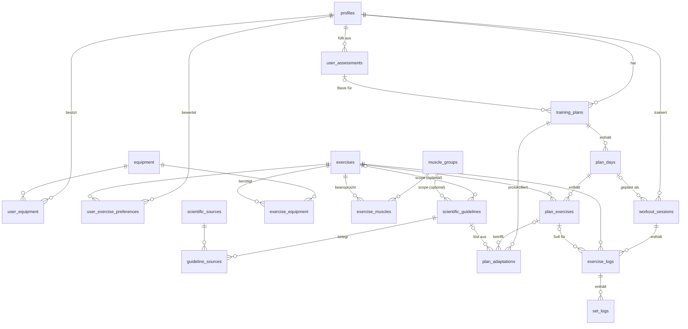

# Schritt 1 – Datenbank-Schema & Datenmodelle

> Status: **Vorschlag zur Freigabe**
> SQL: [`supabase/migrations/20261105000000_initial_schema.sql`](../supabase/migrations/20261105000000_initial_schema.sql)

## Vorgeschlagener Tech-Stack

Die App soll als Web-App auf allen Plattformen laufen. Deshalb:

| Ebene | Wahl | Warum |
|---|---|---|
| Frontend | **Next.js (App Router) + TypeScript + Tailwind CSS** | Ein Code-Stand für Desktop, iOS und Android, Mobile-First |
| Plattform | **Progressive Web App (PWA)** | Auf jedem Handy „zum Startbildschirm hinzufügen“, Vollbild, **offline nutzbar** (Gyms haben oft schlechten Empfang) |
| Backend/DB | **Supabase** (PostgreSQL, Auth, Row Level Security) | Relationales Modell passt zu Trainingsdaten, Auth inklusive, Zugriffsschutz direkt in der DB |
| State | Zustand (Live-Workout) + TanStack Query (Server-Daten) | Workout-Zustand überlebt Reloads, Server-Cache getrennt |
| Offline-Puffer | IndexedDB (Dexie) | Sätze werden lokal gespeichert und später synchronisiert |
| Charts | Recharts | Schritt 5 |

Das Schema ist darauf ausgelegt: Alle IDs sind **UUIDs, die der Client selbst erzeugen kann**. So kann ein Satz
offline angelegt und später per `upsert` hochgeladen werden, ohne ID-Konflikte.

## Überblick: 5 Bereiche, 19 Tabellen, 3 Views



### Zuordnung zu den angefragten Entitäten

| Angefragt | Umsetzung |
|---|---|
| **Users** | `profiles` (verknüpft mit Supabase `auth.users`), `user_assessments`, `user_equipment`, `user_exercise_preferences` |
| **Workouts** | Soll: `training_plans` → `plan_days` → `plan_exercises` · Ist: `workout_sessions` |
| **Exercises** | `exercises` + `exercise_muscles` (primär/sekundär) + `exercise_equipment` |
| **Sets** | Soll: `plan_exercises.target_sets/reps/rir` · Ist: `set_logs` |
| **Logs** | `workout_sessions` → `exercise_logs` → `set_logs` sowie `plan_adaptations` (Änderungen am Plan) |
| **ScientificGuidelines** | `scientific_guidelines` + `scientific_sources` + `guideline_sources` |

Die wichtigste Trennung ist **Soll** (Plan) gegen **Ist** (Log). Ein Plan kann sich ändern, ohne die Historie zu
verfälschen. Die Historie hängt an der Übung (`exercise_id`), nicht am Plan, damit „Letztes Mal“ und die Charts
auch nach einem Planwechsel weiterlaufen.

## Die Tabellen im Detail

### A. Katalog (für alle lesbar, gepflegt per Migration/Admin)

| Tabelle | Zweck | Wichtige Felder |
|---|---|---|
| `muscle_groups` | ca. 17 Muskelgruppen | `slug`, `name_de`, `region` (upper/lower/core) |
| `equipment` | Langhantel, Kurzhantel, Kabel, Maschine, Klimmzugstange, … | `slug`, `name_de` |
| `exercises` | Übungs-Bibliothek mit Detailseite | `instructions[]`, `common_mistakes[]`, `cues[]`, `image_url`/`video_url`/`gif_url`, `mechanic` (compound/isolation), `movement_pattern`, `systemic_fatigue` (1–5), `load_increment_kg`, `tracking_type` |
| `exercise_muscles` | Primär-/Sekundärmuskeln | `role`, `contribution` (1.0 / 0.5) |
| `exercise_equipment` | Benötigtes Equipment | n:m |

Eigene Übungen: `exercises.created_by` ist bei Katalog-Übungen `NULL`. Bei eigenen Übungen steht dort die
Nutzer-ID, und nur dieser Nutzer sieht sie.

### B. Wissenschaft

| Tabelle | Zweck |
|---|---|
| `scientific_sources` | Studien und Positionspapiere (Zitat, Jahr, DOI, Typ: Meta-Analyse, RCT, …) |
| `scientific_guidelines` | Die Richtwerte als **Regeln mit Geltungsbereich** (siehe unten) |
| `guideline_sources` | n:m, jeder Richtwert ist mit seinen Quellen belegt |

### C. Nutzer & Onboarding

| Tabelle | Zweck |
|---|---|
| `profiles` | Anzeige-Einstellungen: `unit_system` (kg/lb), `effort_scale` (RIR oder RPE), `timezone` |
| `user_assessments` | Fragebogen: Ziel, Erfahrung, Tage/Woche, Dauer, Wunsch-Split, Prioritätsmuskeln, Einschränkungen. **Versioniert**: jede Neubewertung ist eine neue Zeile. |
| `user_equipment` | Verfügbares Equipment, filtert die Übungsauswahl |
| `user_exercise_preferences` | Favoriten bzw. „vermeiden“ (z. B. wegen Schulterproblemen) |

### D. Plan (Soll)

| Tabelle | Zweck |
|---|---|
| `training_plans` | Split, Ziel, Mesozyklus-Länge, aktuelle Woche. Maximal **ein aktiver Plan** pro Nutzer (Unique-Index). `parent_plan_id` hält die Herkunft bei Neugenerierung fest. |
| `plan_days` | z. B. „Push A“, „Upper 1“ |
| `plan_exercises` | Vorgabe je Übung: Sätze, Wdh.-Bereich, RIR-Bereich, Pause, **`target_load_kg`** (wird vom Progressions-Algorithmus gepflegt), Progressionsschema |
| `plan_adaptations` | **Protokoll jeder Anpassung**: Typ (Last ↑, Satz +, Übungswechsel, Deload …), Grund (Stagnation, Ziel erreicht …), Vorher/Nachher (JSON), auslösender Richtwert, Status (vorgeschlagen/angenommen/abgelehnt/automatisch) |

### E. Logs (Ist)

| Tabelle | Zweck |
|---|---|
| `workout_sessions` | Eine Trainingseinheit: Status, Start/Ende, Session-RPE, Körpergewicht. Maximal **ein laufendes Workout** pro Nutzer. |
| `exercise_logs` | Eine Übung in der Einheit, optional mit Verweis auf die Plan-Vorgabe |
| `set_logs` | Ein Satz: `set_type` (warmup/working/backoff/dropset/amrap), `weight_kg`, `reps`, `duration_seconds`, `rir`, tatsächliche Pause, sowie **`e1rm_kg`** als berechnete Spalte |

### F. Views für Tracker und Charts

| View | Liefert | Wird genutzt für |
|---|---|---|
| `exercise_last_performance` | Arbeitssätze der letzten abgeschlossenen Einheit je Übung (als JSON) | „Letztes Mal: 82,5 kg × 8 / 8 / 6“ im Live-Tracker |
| `exercise_progress` | Je Übung und Einheit: Topgewicht, bestes e1RM, Tonnage, Sätze | Kraft-Charts, Stagnations-Erkennung |
| `weekly_muscle_volume` | Harte Sätze je Muskelgruppe und Kalenderwoche | Volumen-Charts, Warnungen bei zu wenig oder zu viel Volumen („Junk Volume“) |

Alle Views laufen mit `security_invoker`. Damit gelten die RLS-Regeln der Basistabellen, und jeder Nutzer sieht nur
seine eigenen Daten.

## Wie die wissenschaftlichen Richtwerte mit den Übungen verknüpft sind

### Die Idee: Regeln mit Geltungsbereich und einer Spezifitäts-Kaskade

Statt jede Übung einzeln mit Richtwerten zu verknüpfen (bei ca. 100 Übungen × 3 Zielen × 3 Erfahrungsstufen wären
das tausende Zeilen), ist jeder Richtwert eine **Regel mit optionalem Geltungsbereich**:

```
scientific_guidelines
  category        rep_range | rest_interval | proximity_to_failure | weekly_volume | …
  scope_goal              ┐
  scope_experience        │  NULL  = gilt für alle
  scope_mechanic          │  Wert  = muss zum Kontext passen
  scope_muscle_group_id   │
  scope_movement_pattern  │
  scope_exercise_id       ┘
  min_value, max_value, unit
  title, message ("Lass {min}–{max} Wiederholungen im Tank"), rationale, evidence_grade
```

Eine Übung **erbt** Richtwerte über ihre Eigenschaften (Mechanik, Bewegungsmuster, Primärmuskeln). Passen mehrere
Regeln derselben Kategorie, gewinnt die **spezifischste**. Das funktioniert ähnlich wie bei CSS:

| Ebene | Gewicht |
|---|---|
| konkrete Übung | 32 |
| Bewegungsmuster | 16 |
| Muskelgruppe | 8 |
| Mechanik (compound/isolation) | 4 |
| Erfahrungsstufe | 2 |
| Ziel | 1 |

Die Gewichte sind Zweierpotenzen. Dadurch kann eine spezifischere Ebene nie durch eine Kombination allgemeinerer
Ebenen überstimmt werden. Die `specificity` ist eine **berechnete Spalte**, niemand muss sie von Hand pflegen.

### Beispiel (so im Test durchgelaufen)

Regeln in der Datenbank:

| key | Kategorie | Geltungsbereich | Wert | Spezifität |
|---|---|---|---|---|
| `rep_range.hypertrophy` | rep_range | Ziel = Hypertrophie | 6–12 Wdh. | 1 |
| `rep_range.hypertrophy.isolation` | rep_range | Ziel = Hypertrophie, Isolation | 10–20 Wdh. | 5 |
| `rep_range.hypertrophy.calves` | rep_range | … + Muskel = Waden | 12–25 Wdh. | 13 |
| `rir.default` | proximity_to_failure | – | RIR 0–3 | 0 |
| `rir.compound` | proximity_to_failure | Compound | RIR 1–3 | 4 |
| `rir.deadlift` | proximity_to_failure | Übung = Kreuzheben | RIR 2–3 | 32 |
| `rest.compound` | rest_interval | Compound | 120–180 s | 4 |
| `rest.isolation` | rest_interval | Isolation | 60–120 s | 4 |

Ergebnis von `resolve_exercise_guidelines(übung, 'hypertrophy', 'intermediate')`:

| Übung | Wdh. | RIR | Pause |
|---|---|---|---|
| Bankdrücken | 6–12 | 1–3 (compound) | 120–180 s |
| Seitheben | 10–20 (isolation) | 0–3 (default) | 60–120 s |
| Wadenheben | 12–25 (Waden) | 0–3 | 60–120 s |
| Kreuzheben | 6–12 | **2–3 (Override wegen hoher systemischer Ermüdung)** | 120–180 s |

Für Volumen und Frequenz gibt es `resolve_muscle_guidelines(muskel, ziel, erfahrung)`. Damit bekommen Anfänger
z. B. 6–10 Sätze pro Woche statt 10–20.

### Wo die Richtwerte eingesetzt werden

1. **Plan-Generierung (Schritt 3):** Die aufgelösten Werte werden als Startwerte in `plan_exercises` kopiert
   (Sätze, Wdh.-Bereich, RIR, Pause). Der Nutzer kann sie danach überschreiben.
2. **Live-Tracker (Schritt 4):** Beim Start eines Workouts werden die Richtwerte für alle Übungen in einem Aufruf
   geladen und **lokal zwischengespeichert**. Die Auswertung („11 Wdh. bei RIR 0, nächstes Mal +2,5 kg“) läuft als
   reine TypeScript-Logik im Client und funktioniert dadurch auch offline.
3. **Kontextsteuerung:** `contexts[]` legt fest, wo ein Richtwert erscheint (Onboarding, Plan-Builder,
   Übungsdetailseite, Tracker, Analyse). `severity` (info/tip/warning) steuert die Darstellung.
4. **Transparenz:** Jede automatische Plananpassung speichert in `plan_adaptations.guideline_id`, welcher Richtwert
   sie ausgelöst hat. Die App kann so immer erklären, *warum* etwas geändert wurde, inklusive Quelle.

### Wie das Schema die Plan-Adaption trägt (Vorschau Schritt 3)

| Signal (aus den Daten) | Quelle | Reaktion → `plan_adaptations` |
|---|---|---|
| Alle Arbeitssätze am oberen Ende des Wdh.-Bereichs bei Ziel-RIR | `set_logs` gegen `plan_exercises` | `increase_load` um `exercises.load_increment_kg` (doppelte Progression) |
| Bestes e1RM steigt über 3 oder mehr Einheiten nicht | `exercise_progress` | Vorschlag `swap_exercise` (gleiches Bewegungsmuster, gleicher Primärmuskel, verfügbares Equipment, nicht „vermeiden“) oder `deload` |
| Wochenvolumen unter dem Minimum | `weekly_muscle_volume` gegen `resolve_muscle_guidelines` | `add_set` |
| Wochenvolumen über dem Maximum | dito | Warnung „Junk Volume“ bzw. `remove_set` |
| Hohe Session-RPE und sinkende Leistung | `workout_sessions.session_rpe`, `exercise_progress` | `deload` |

## Wichtige Design-Entscheidungen

| Entscheidung | Begründung |
|---|---|
| **Gewicht immer in kg** | Keine gemischten Einheiten in Auswertungen. lb ist reine Anzeige (`profiles.unit_system`). |
| **Anstrengung immer als RIR** | Eine einzige gespeicherte Skala. RPE wird angezeigt als `10 − RIR` (RIR-basierte RPE-Skala, Zourdos et al. 2016, Helms et al. 2016). |
| **Fraktionale Sätze** | Sekundärmuskeln zählen mit `contribution = 0.5`. Ein Satz Bankdrücken zählt also 1 Satz Brust und 0,5 Sätze Trizeps (gängige Zählweise in der Volumenforschung). |
| **„Harter Satz“ = Arbeitssatz mit RIR ≤ 4** | Aufwärmsätze und sehr leichte Sätze zählen nicht zum Volumen. |
| **e1RM nur bei 1–12 Wdh. und RIR ≤ 4** | Epley-Formel, RIR-korrigiert. Bei vielen Wdh. oder großem Abstand zum Versagen sind die Schätzungen zu ungenau und würden die Kraft-Charts verfälschen. |
| **Wochengrenzen in Nutzer-Zeitzone** | Ein Training am Sonntag um 23:30 Uhr zählt nicht in die nächste Woche. |
| **Assessments und Anpassungen versioniert** | Nachvollziehbar, warum ein Plan so aussieht, wie er aussieht. |
| **Row Level Security auf allen Tabellen** | Katalog lesbar, Nutzerdaten strikt isoliert. Kindtabellen (Sätze, Plan-Tage) erben den Schutz über ihre Eltern-Datensätze. |

## Getestet

Die Migration wurde lokal gegen **PostgreSQL 16** ausgeführt, mit einem Nachbau der Supabase-Rollen und des
`auth`-Schemas. Geprüft wurden:

- Richtwert-Auflösung: alle Beispiele aus der Tabelle oben, inklusive Anfänger-Volumen
- Automatisches Anlegen des Profils bei der Registrierung
- e1RM-Berechnung, „Letztes Mal“-View, Verlaufs-View, Wochenvolumen mit fraktionalen Sätzen und Zeitzone
- Höchstens ein aktiver Plan pro Nutzer
- RLS: Nutzer B sieht keine Daten von A (auch nicht über die Views), kann keine Sätze in fremde Logs schreiben,
  keine Session an fremde Pläne hängen, keine Katalog-Übungen oder Richtwerte anlegen; eigene Übungen bleiben privat

## Wissenschaftliche Grundlage der Kategorien (wird in Schritt 3 mit DOIs geseedet)

| Kategorie | Kernaussage | Hauptquellen |
|---|---|---|
| Wiederholungsbereich | Hypertrophie ist über ein breites Spektrum (ca. 6–30 Wdh.) ähnlich, wenn nahe ans Versagen trainiert wird. 6–12 ist zeiteffizient. Für Maximalkraft sind schwere Lasten (1–5 Wdh.) überlegen. | Schoenfeld et al. 2021 (Repetition Continuum) |
| Nähe zum Versagen | Hypertrophie profitiert von Sätzen nahe am Versagen (ca. 0–3 RIR). Echtes Versagen ist nicht nötig. Kraft hängt weniger davon ab. | Refalo et al. 2023, Robinson et al. 2024 |
| Pausen | Längere Pausen (≥ 2 min) bei schweren Mehrgelenksübungen verbessern Kraft und Volumen. | Schoenfeld et al. 2016, Grgic et al. 2018 |
| Wochenvolumen | Dosis-Wirkungs-Beziehung, ≥ 10 Sätze pro Muskel und Woche sind wirksamer, mit abnehmendem Zusatznutzen. | Schoenfeld, Ogborn & Krieger 2017 |
| Frequenz | Jeden Muskel mindestens 2×/Woche trainieren, um das Volumen sinnvoll zu verteilen. | Schoenfeld, Grgic & Krieger 2019 |
| Kraftausdauer | Höhere Wiederholungszahlen, kurze Pausen | ACSM Position Stand 2009 |

Jeder Richtwert bekommt eine `evidence_grade` (strong/moderate/limited/expert_opinion). Die App kann so ehrlich
anzeigen, wie gut eine Empfehlung belegt ist. Ein Beispiel ist die Grenze von ca. 6–10 Sätzen pro Muskel und
Einheit: Sie ist eher Expertenkonsens als harte Evidenz und wird entsprechend gekennzeichnet.
